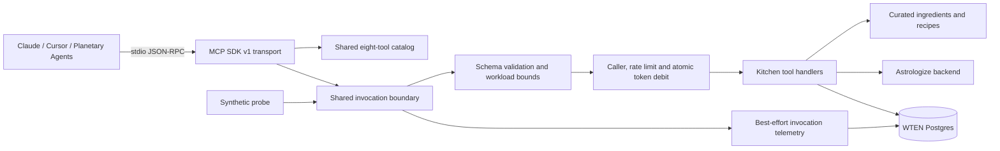

# Alchm.kitchen MCP architecture

Version **1.3.0** keeps the kitchen server focused on culinary data, astronomical calculations and the existing recipe/economy workflows. Planetary Agents owns personas, memory and deliberation. Kitchen does not copy those tools or connect to the agents database.

The only MCP transport shipped here is stdio. The Node bundle and compiled Bun sidecar use the same handlers as source runs. Existing protocol initialization remains on the compatible SDK v1 line; this release does not migrate to the separate v2 package/protocol surface.

## Code ownership

| Module                                   | Responsibility                                                                    |
| ---------------------------------------- | --------------------------------------------------------------------------------- |
| `src/lib/mcp/catalog.ts`                 | Dependency-free tool names, version, descriptions and annotations. |
| `src/lib/mcp/inputSchemas.ts`            | Shared input schemas used by discovery and runtime validation. |
| `src/lib/mcp/validation.ts`              | Validate the catalog's JSON Schema subset before expensive/authenticated work.    |
| `src/lib/mcp/execution.ts`               | Process concurrency, deadlines and cancellation context.                          |
| `src/lib/mcp/tools.ts`                   | Shared invocation boundary and culinary handlers.                                 |
| `src/lib/mcp/synastryTools.ts`           | Synastry aspects, cache and transit/natal overlays.                               |
| `src/lib/mcp/auth.ts`                    | Credential resolution and ESMS billing policy.                                    |
| `src/lib/mcp/rateLimit.ts`               | Per-key/anonymous process-local sliding windows.                                  |
| `src/lib/mcp/invocationLog.ts`           | Sanitized, best-effort telemetry writes.                                          |
| `mcp-server/src/index.ts`                | Stdio registration, structured/text envelopes and shutdown.                       |
| `mcp-server/src/__tests__/stdio.test.ts` | Real-process protocol regression tests.                                           |

The shared catalog contains eight tools: `get_live_sky_transits`, `alchemize_ingredients`, `generate_cosmic_recipe`, `compute_synastry_overlay`, `get_transit_natal_overlay`, `compute_triplicate_synastry`, `create_evidence_snapshot` and `submit_recipe_reflection`. Both stdio and in-process callers pass through `invokeTool`; the catalog and runtime validator cannot drift into separate input contracts.

## Authentication and effects

Calls can carry `_meta.apiKey`/legacy argument aliases, or inherit `MCP_USER_API_KEY` (`ALCHM_MCP_USER_API_KEY` alias). Credentials require WTEN Postgres for validation; the production chart URL supplies astronomical calculation, not remote API-key authentication. Anonymous callers use read tools in demo mode. Reflection publication requires an authenticated non-synthetic user.

Authenticated recipe searches and evidence snapshots cost 2.5 of each ESMS axis; reflections cost 0.1 of each axis. A failed debit prevents handler execution. Paid calls are marked non-read-only and non-idempotent because retrying may debit again. Synastry is marked non-read-only because its explicit write cache strategy changes persistent state; that strategy requires a matching internal probe secret, and read/bypass calls do not upsert natal records. Reflection publication can create a reflection, interaction and feed event; these writes are not a single all-or-nothing transaction.

Synthetic exemptions require an explicit matching `_meta.internalSecret`; merely configuring a server secret does not exempt external callers. Credentials and reflection text are not retained in invocation arguments. Correlation IDs connect a request to sanitized telemetry.

## Runtime and packaging

Before dynamically importing application services, the entrypoint redirects console log/info/debug to stderr. This covers initialization logs as well as handler logs. Stdout is reserved for newline-delimited JSON-RPC. SIGINT, SIGTERM, SDK closure and stdin EOF share a guarded shutdown that drains pending telemetry for up to one second. Successful results and tool failures expose an object in `structuredContent` plus an identical serialized text object for existing clients.

Explicit backend URL settings win. Bundles/sidecars default to `https://alchm.kitchen`; raw source defaults to the developer's localhost app. The bundle includes the application calculation/catalog code and declares `pg` as a runtime dependency. The binary includes its runtime, disables dotenv/bunfig autoloading, and is ad-hoc signed and verified on macOS. Package version, catalog/server handshake version and registry metadata are synchronized at 1.3.0; build and protocol tests precede any publication.

The invocation boundary applies schema bounds, per-key rate limits, a four-call concurrency cap and a cancellation deadline of 20 seconds. Cancellation is forwarded from MCP request context. These are process-local controls, not distributed quotas or guarantees of rollback for downstream work already started. Database telemetry records calls for the admin surface and synthetic probe; telemetry failure does not change a tool's success.
